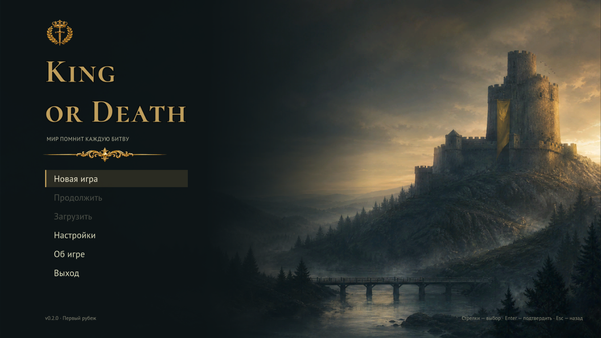
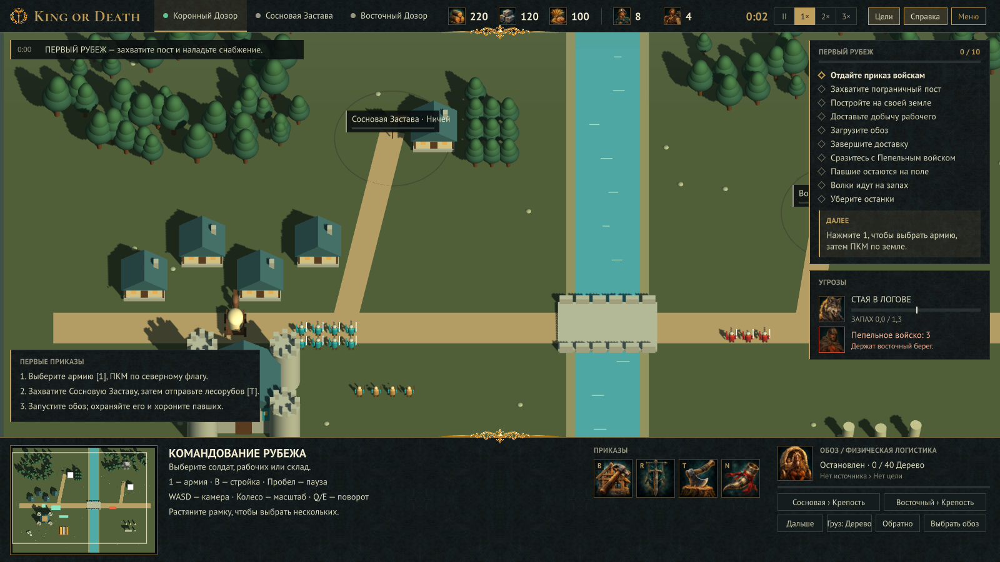

# KING OR DEATH
**A World Remembers Every Battle**

`v0.2.0-prototype` · Single-player fantasy RTS · **The First Frontier**





## Запуск
1. Откройте папку проекта через Unity Hub в **Unity 6000.6.10f1** (Unity 6.6, URP 17.6.0).
2. Дождитесь импорта пакетов. Откройте `Assets/_Game/Scenes/MainMenu.unity` (стартовый экран) или сразу `Prototype_01.unity`.
3. Нажмите Play. Сцены уже сохранены в проекте, генерация не требуется.
4. Либо распакуйте Windows-релиз **целиком** и запустите `KingOrDeath.exe`. Папка `KingOrDeath_Data` и DLL должны оставаться рядом с EXE.

Использована установленная версия Unity 6.6, **не LTS**. Импорт в другие версии не проверен. Windows x64. Интерфейс и озвучка на русском и английском (язык — в настройках). Масштаб интерфейса 85–130% (Настройки → Игра); на экранах уже 16:9 интерфейс подстраивается по ширине, в тесноте HUD переходит в компактный режим.

## Управление
| Действие | Управление |
|---|---|
| Камера | WASD / стрелки / средняя кнопка мыши / край экрана (отключается в настройках) |
| Масштаб, поворот | Колесо мыши, Q / E |
| К крепости / общий вид | Home / F1 |
| Выделение | ЛКМ, рамка; Shift добавляет; ЛКМ по портрету в сетке — оставить одного |
| Выбрать всю армию | 1 |
| Движение / атака / добыча | ПКМ по земле / противнику / дереву, камню или полю |
| Уборка останков | Рабочий + Z / X / C (похоронить / сжечь / спрятать), ПКМ по телу |
| Перенос тела | V, ПКМ по телу, затем ПКМ по земле; G — бросить |
| Приказы | F — охранять обоз, H — стой, B — строить дом, R — нанять мечника, T — лесорубы, N — вызвать набег |
| Склад | Вкладка в верхней панели или ЛКМ по крепости / складу поста |
| Пауза, скорость | Пробел; кнопки II / 1× / 2× / 3× |
| Сохранение / загрузка | F5 / F9; меню паузы |
| Меню паузы | Esc / кнопка «Меню» |
| Камера к месту | ЛКМ по миникарте или по записи журнала |

Наведите курсор на любую кнопку приказа, ресурс, угрозу или цель — появится подсказка.

## Сценарий «Первый рубеж» (10–15 минут)
1. Нажмите `1` и отправьте мечников к северному флагу **Сосновой Заставы**. Захват занимает 14 секунд без противодействия.
2. Приказ **Лесорубы** (T): двое рабочих рубят лес у захваченного поста. Вручную — ПКМ по дереву.
3. В панели обоза выберите **Сосновая › Крепость**. Обоз загрузит местное дерево и привезёт его в **Коронный Дозор**; пустой склад заставляет его ждать.
4. Нажмите B и поставьте дом в зелёном радиусе. 50 дерева и 20 камня списываются **с местного склада**. Дорога, река, здания и чужая земля запрещены; дом не расширяет территорию.
5. Отправьте мечников к мосту и сразитесь с восточной группой. **Вызвать набег** (N) однократно приводит ещё пятерых.
6. Через 16 секунд неубранные останки начинают пахнуть. Волки идут на запах и нападают на всех по пути, включая рабочих и обоз.
7. Назначьте охрану обоза (F) или отправьте рабочих убирать тела. Похороны и сожжение убирают запах, укрытие ослабляет, перенос уносит.
8. Захватите **Восточный Дозор**, пустите второй маршрут, смените направление или груз. Победа — все 10 целей, поражение — не осталось ни мечников, ни рабочих.

## Что есть в игре
**Меню и экраны** (UI Toolkit)
- Главное меню с тлеющими искрами и медленным наездом на арт, поочерёдным появлением пунктов и карточкой «Продолжить» с миниатюрой последнего сохранения.
- Выбор сценария, экран загрузки с советами, Кодекс (юниты и механики с портретами), «Об игре».
- Настройки с сохранением: экран, качество, FPS, громкость (общая, музыка, эффекты, голос), язык, подсказки, масштаб интерфейса, прокрутка у краёв экрана, скорость камеры, цифры урона, постоянные полосы здоровья.
- Меню паузы, сохранение и загрузка по слотам с миниатюрами, удалением и перезаписью, подтверждения перед потерей прогресса, экран победы или поражения со статистикой. Затемнение при переходах между сценами.

**HUD**
- Верхняя панель: вкладки складов с владельцем, ресурсы с иконками и всплывающими изменениями, численность армии и рабочих, часы и скорость матча.
- Журнал событий: тревоги выделены, клик переносит камеру к месту. Цели с прогрессом и подсказкой «Далее», панель угроз (запах и стая, Пепельное войско).
- Крупные анонсы событий со стингером и голосом советника: набег, стая, захват или потеря поста, первая доставка, гибель обоза, «наших людей атакуют».
- Выделенный юнит: портрет, полоса здоровья, состояние. Несколько юнитов — сетка портретов. Склад — его запасы.
- Карта приказов с иконками, горячими клавишами, ценой и подсказками. Панель обоза.
- Миникарта из рендера карты сверху: рамка обзора, пинги событий, останки.
- В мире: кольца выделения и наведения, полосы здоровья с делениями, всплывающий урон, маркеры приказов, подсказка при наведении, свои курсоры.

**Звук и голос**
- Музыка меню и матча, эмбиент рубежа, стингеры событий, звуки интерфейса на всех кнопках, голос рассказчика и советника на двух языках; музыка приглушается, пока звучит голос.

**Сохранения**
- JSON в `%USERPROFILE%/AppData/LocalLow/KingOrDeath/KING OR DEATH/saves`: склады, владение и прогресс захвата, юниты с позициями и здоровьем, грузы и задания рабочих, маршрут обоза и охрана, остатки ресурсов и обломки, дома, останки с возрастом и состоянием, цели, статистика, камера. Автосохранение каждые 3 минуты, быстрое — F5 / F9.

**Симуляция**
- Каменная крепость, поселение, 2 поста, лесное логово, река с единственным мостом, руины, дорога, поля; процедурные оригинальные модели.
- Выделение рамкой, приказы, A* по сетке с пересчётом после строительства, ближний бой, найм мечников.
- Оспаривание флага и повторный захват; строительные радиусы крепости и постов.
- Три вида ресурсов, физическая добыча и локальные склады; рейсы обоза с ограниченным грузом, остановкой, сменой груза, маршрута и охраной; уничтожение обоза и сбор половины груза.
- Останки до конца матча: похороны, сожжение, укрытие, перенос. Периодическая экология: возраст, количество, расстояние до логова и цели волков. Настройки в `FrontierConfig.asset`.

## Ограничения
Это проверяемый прототип, не готовая RTS. Нет сетевой игры, развитого ИИ экономики, осад, разложения, нежити, духов и магии. Дом — оплачиваемая постройка и препятствие, без населения и производства. Нет анимаций юнитов, формаций с учётом препятствий и физики колёс; юниты мягко расталкиваются, декоративные деревья и камни не блокируют путь. При гибели рабочего его груз пропадает. Сохранение не хранит идентичность юнитов: цели атаки и задания по уборке останков после загрузки сбрасываются. Старые записи журнала не переводятся при смене языка.

## Инструменты
- `tools/art_gen.py` — арт меню, иконки и портреты, орнаменты, фактура панелей (kie.ai GPT Image 2).
- `tools/audio_gen.py` — звуки интерфейса (синтез), стингеры, эмбиент и музыка (kie.ai Suno), голос рассказчика и советника (ElevenLabs через kie.ai).

Ключ kie.ai — переменная `KIE_API_KEY`; скрипты его не печатают. Подробности — в [архитектуре](Docs/Architecture.md).

## Проверка и сборка
В меню Unity: **KING OR DEATH → Rebuild prototype scene** пересоздаёт игровую сцену, **Rebuild menu scene and pause menu** — сцену меню и объект паузы. Это намеренно заменяет текущую прототипную сцену; не используйте после ручных изменений без коммита.

Командная строка (подставьте путь Unity):
```powershell
Unity.exe -batchmode -quit -projectPath "PATH/KingOrDeath" -executeMethod KingOrDeath.Editor.PrototypeBuilder.BuildDeliverables -logFile build.log
./Builds/Windows/KingOrDeath.exe -verify "PATH/test-results" -screen-width 1600 -screen-height 900 -logFile "PATH/player.log"
```
`-verify` запускает ускоренный интеграционный сценарий через рабочие игровые компоненты, сохраняет отчёт и скриншот и завершает приложение (0 — все проверки пройдены; 1 — ошибка; 2 — таймаут). EditMode-тесты — `Assets/_Game/Tests/EditMode` (Test Runner).

См. [фактический отчёт](Docs/TestReport.md), [дизайн](Docs/GDD.md), [архитектуру](Docs/Architecture.md), [следующие этапы](Docs/Roadmap.md).

Все игровые модели созданы процедурно для этого проекта; чужие игровые ассеты не использованы. Арт, иконки и орнаменты сгенерированы GPT Image 2, музыка и стингеры — Suno, голос — ElevenLabs (все через kie.ai); звуки интерфейса синтезированы, курсоры нарисованы. Шрифты Cormorant SC и PT Sans — SIL OFL (лицензии в `Assets/_Game/Art/Fonts`). Unity и URP регулируются лицензиями их правообладателя. Отдельная открытая лицензия на исходный код владельцем пока не выбрана.
