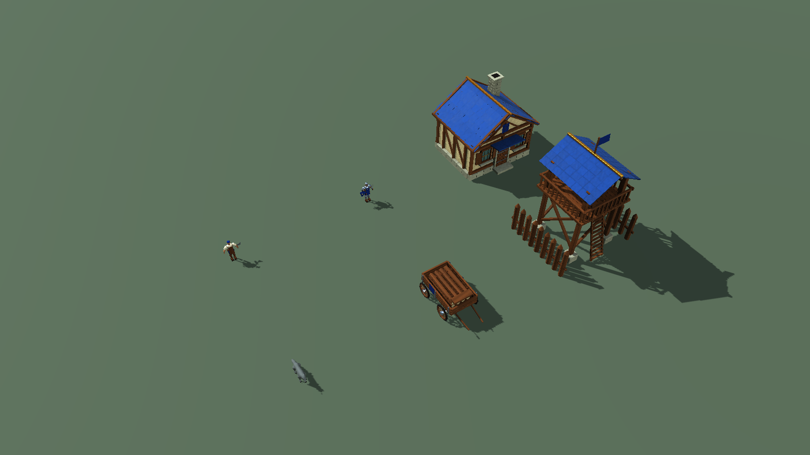
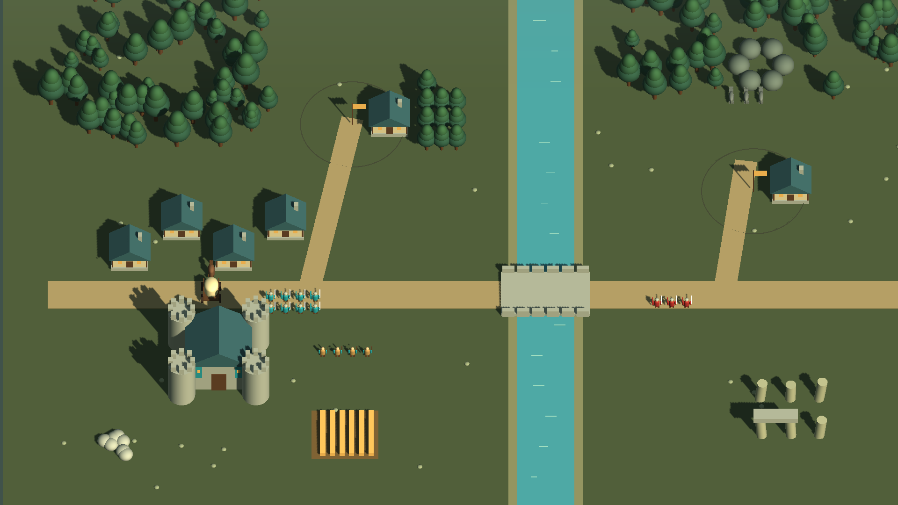

# Asset Pack 001 — шесть интегрированных моделей

Ветка `feature/asset-pack-001`: дом, мечник, рабочий, волк, пост и обоз. Сохранены `.blend`, FBX, PBR-текстуры, три LOD, Unity Prefabs и 19 анимационных клипов. Художественный статус комплекта — **Needs Improvement**; качество референсов пока не достигнуто, расширенная библиотека не готова.

**Основа ветки:** прототип `36db810`. Новые меню, сохранения и брифинг из `main` (`54e3d3c`) сюда не объединены; совместимость с ними ещё требует отдельной проверки.



[Подробный отчёт, ограничения и пути](Docs/AssetValidationReport.md) · [Проверки ассетов](Docs/AssetRuntimeValidation.txt) · [Проверки игровых механик](Docs/ArtIntegrationValidation.txt)

Для осмотра откройте `Assets/_Game/Scenes/AssetShowcase_01.unity`: 1–6 — модель, ПКМ — вращение, колесо — масштаб, кнопки — доступные клипы. Игровая сцена — `Prototype_01.unity`. Windows-сборки находятся в `Builds/AssetShowcase` и `Builds/Windows`. Исходники — `ArtSource/Blender`, воспроизводимые скрипты — `ArtSource/Tools`.

Не запускайте `PrototypeBuilder.BuildDeliverables` для этой ветки: он пересоздаёт базовую сцену. Для полной пересборки ассетов используйте `ArtPackImporter.BuildAll`, для игровой сборки — `ArtPackImporter.BuildGameplay`. Исходный прототип остаётся в `main` и релизе `v0.1.0-prototype`.

---

# KING OR DEATH
**A World Remembers Every Battle**

`v0.1.0-prototype` · Single-player fantasy RTS · **The First Frontier**



## Запуск
1. Откройте папку проекта через Unity Hub в **Unity 6000.6.10f1** (Unity 6.6, URP 17.6.0).
2. Дождитесь импорта пакетов. Откройте `Assets/_Game/Scenes/Prototype_01.unity`.
3. Нажмите Play. Сцена уже сохранена в проекте, генерация не требуется.
4. Либо распакуйте Windows-релиз **целиком** и запустите `KingOrDeath.exe`. Папка `KingOrDeath_Data` и DLL должны оставаться рядом с EXE.

Использована установленная версия Unity 6.6, **не LTS**. Импорт в другие версии не проверен. Windows x64, рекомендуемое окно 1600×900 или шире. Интерфейс прототипа на английском.

## Управление
| Действие | Управление |
|---|---|
| Перемещение камеры | WASD / стрелки / средняя кнопка мыши |
| Масштаб, поворот | Колесо мыши, Q / E |
| Вернуться к крепости / общий вид | Home / F1 |
| Выделение | ЛКМ, рамка; Shift добавляет |
| Выбрать всю армию | 1 |
| Движение / атака | ПКМ по земле / противнику |
| Добыча | Выделить рабочего, ПКМ по дереву, камню или полю |
| Уборка останков | Выделить рабочего, выбрать Bury/Burn/Hide/Carry, ПКМ по телу |
| Перенос тела | Carry, ПКМ по телу, затем ПКМ по земле; Drop body |
| Строительство | B / Build house; ЛКМ подтвердить; Esc / ПКМ отменить |
| Локальные ресурсы | ЛКМ по крепости или зданию склада поста |
| Пауза / перезапуск | Space / кнопки верхней панели |
| Камера по миникарте | ЛКМ по миникарте |

## Сценарий на 10–15 минут
1. Нажмите `1` и отправьте мечников к северному флагу **Pineward**. Захват занимает 14 секунд без противодействия.
2. Выберите **Wood crew**: два обычных рабочих отправятся рубить лес у захваченного поста. При ручном управлении используйте ПКМ по дереву.
3. Выберите **Pineward → Keep**. Обоз поедет к складу, загрузит местную древесину и привезёт её в Crownwatch. Пустой склад заставляет его ждать.
4. Нажмите B и постройте дом на зелёном участке. Стоимость 50 древесины / 20 камня списывается **с конкретного местного склада**. Дорога, река, здания и чужая территория запрещены. Дом не расширяет зону.
5. Отправьте мечников к мосту и сразитесь с восточной группой. **Call raid** однократно вызывает ещё пять противников со стороны восточной дороги.
6. Через 16 секунд останки начинают привлекать волков из лесного логова. Они идут к запаху и атакуют встреченную добычу, включая работников и обоз.
7. Назначьте сопровождение кнопкой **Escort caravan** или направьте рабочих убирать тела. Захоронение / сжигание устраняет запах; укрытие снижает его; перенос позволяет унести останки.
8. Захватите **Eastwatch**, настройте второй маршрут или измените направление / тип груза. Это отдельный строительный анклав.

## Реализовано
- Каменная крепость, поселение, 2 поста, лесное логово, река с единственным мостом, руины, дорога, поля и процедурные оригинальные модели.
- Выделение рамкой, приказы, A* по сетке с препятствиями и пересчётом после строительства, ближний бой, здоровье, найм мечников.
- Оспаривание флага и повторный захват; строительные радиусы крепости и постов.
- Три вида ресурсов, физическая добыча и локальные склады; повторяющиеся рейсы обоза с ограниченным грузом, остановкой, сменой груза, маршрута и сопровождением.
- Уничтожение обоза и сбор половины выпавшего груза рабочими.
- Останки сохраняются до конца текущего матча. Захоронение, сжигание, укрытие и перенос обычным рабочим.
- Периодическая экология: возраст, количество, расстояние до логова и локальные цели волков. Настройки в `FrontierConfig.asset`.
- Тёмный интерфейс, миникарта, здоровье, шкалы захвата, журнал уведомлений и список целей сценария.

## Ограничения
Это небольшой проверяемый прототип, не готовая RTS. Нет сохранения матча на диск, сетевой игры, развитого ИИ экономики, осад, разложения, нежити, духов и магии. Дом пока является оплачиваемой постройкой и препятствием, но не даёт населения / производства. Анимации, звук, формации, взаимное избегание юнитов и физика колёс требуют отдельного этапа. Персонажи могут пересекаться; навигация блокирует здания и реку, декоративные деревья и камни не блокируют путь. При убийстве рабочего переносимые им ресурсы теряются. Полноценная локализация и масштабирование HUD для узких окон не выполнены.

## Повторная проверка и сборка
В меню Unity: **KING OR DEATH → Rebuild prototype scene** пересоздаёт сцену. Это намеренно заменяет текущую прототипную сцену; не используйте после ручных изменений без коммита.

Командная строка (подставьте путь Unity):
```powershell
Unity.exe -batchmode -quit -projectPath "PATH/KingOrDeath" -executeMethod KingOrDeath.Editor.PrototypeBuilder.BuildDeliverables -logFile build.log
./Builds/Windows/KingOrDeath.exe -verify "PATH/test-results" -screen-width 1600 -screen-height 900 -logFile "PATH/player.log"
```
`-verify` запускает ускоренный интеграционный сценарий через рабочие игровые компоненты, сохраняет отчёт и скриншот, затем завершает приложение (0 — все проверки пройдены; 1 — ошибка; 2 — таймаут).

См. [фактический отчёт](Docs/TestReport.md), [дизайн](Docs/GDD.md), [архитектуру](Docs/Architecture.md), [следующие этапы](Docs/Roadmap.md).

Все игровые модели созданы процедурно для этого проекта; чужие игровые ассеты не использованы. Unity и URP регулируются лицензиями их правообладателя. Отдельная открытая лицензия на исходный код владельцем пока не выбрана.
